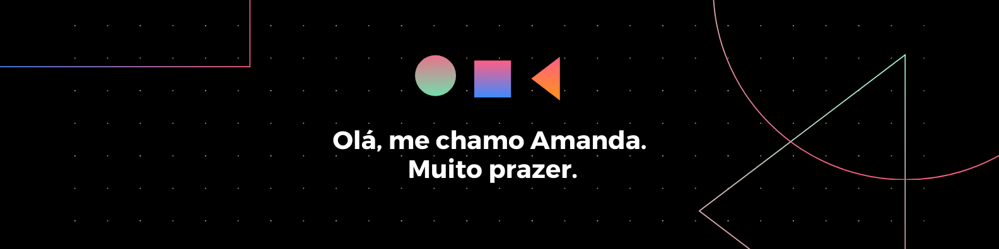

---

<h3 align="center">Transformando criatividade em código, dados em decisões e qualidade em experiências reais.</h3>

---

### 👩‍💻 Sobre mim

Sou apaixonada por tecnologia, design e inovação. Atuo nas áreas de:

- 🎨 **Front-End**: Desenvolvimento de interfaces modernas, acessíveis e responsivas com HTML, CSS, JavaScript e frameworks.
- ✅ **Testes e Automação**: Automatização de testes e organização de fluxos com Selenium, Trello e Postman.
- 📊 **Análise de Dados**: Transformo dados em insights com ferramentas como SQL, Python, Power BI e Excel avançado.

> Sempre aprendendo, sempre evoluindo. 🌱

---

### 🚀 Tecnologias e Ferramentas

  
<table>
  <tr>
    <td valign="top">

#### 🌐 Front-End

#### 🧪 Testes e Organização

#### 📈 Dados & BI

</td>
<td valign="top">
  

</td>
  </tr>
</table>

---

### 💡 Projetos em Destaque
  
🔹 [**Inove BI**](https://inovebi.com/) – Site institucional para empresa Inove.  
🔹 [**Instituto Somos Aldeia**](https://institutosomosaldeia.vercel.app/index.html) – Projeto voluntário para causa social voltada às mães atípicas.

---

### 📫 Vamos nos conectar?

- 👩‍💻 [Portifólio](https://portifolio-amanda-serena.vercel.app/)
- 💼 [LinkedIn](https://www.linkedin.com/in/amanda-serena-53aa73264/)
- 📧 Email: amandasserena@rede.ulbra.com

---

  

---

  <picture>
    <source media="(prefers-color-scheme: dark)" srcset="https://raw.githubusercontent.com/AmandaSserena/AmandaSserena/output/pacman-contribution-graph-dark.svg">
    
  </picture>

---

---

###
